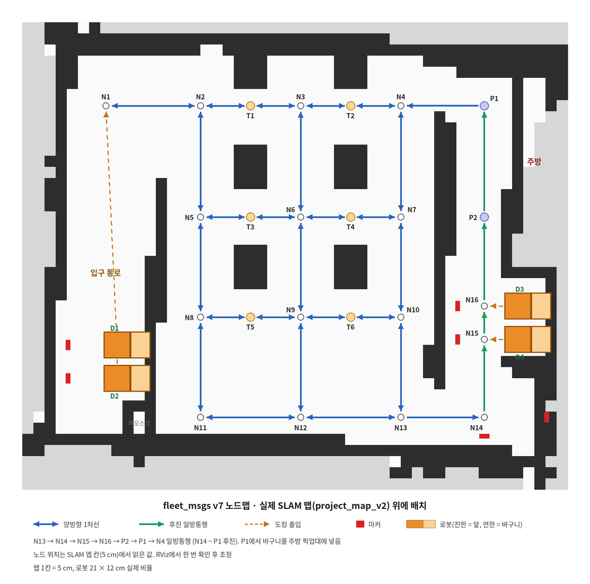

# fleet_msgs v7.1 — 서빙 로봇 3대 로봇 ↔ 서버 인터페이스

음식 서빙·그릇 회수 시나리오에서 Pinky Pro 로봇 3대(`pinky1`, `pinky2`, `pinky3`)와 중앙 서버(노트북)가 주고받는 ROS 2 메시지 규약입니다.
이 문서는 **팀원과 AI 어시스턴트가 이 프로젝트의 규칙을 정확히 이해하도록** 쓴 기준 문서입니다.
코드나 다른 문서와 내용이 다르면 이 문서를 기준으로 하고, 바뀐 내용은 이 문서부터 고칩니다.

- ROS 2 배포판: **Jazzy**
- 패키지 버전: 0.7.1 (바뀐 점은 [10장](#10-변경-이력). v6은 건너뛰고 맵 이름 v7에 맞춤)
- 로봇 스펙 전제: LCD 화면(출력만, 터치 없음), 카메라, 배터리 잔량 읽기 가능. **로봇에는 입력 장치가 없다.**

---

## 0. 한눈에 보기

```
[주방 GUI]  [손님 GUI]          ← 버튼 입력은 전부 여기서 (fleet_msgs 범위 밖)
      │         │
      ▼         ▼
[서버]  작업 관리 · 로봇 배정 · 경로 계산 · 노드 lock · 타이머       (도메인 0)
   │  fleet/move, fleet/control, fleet/display
   │  ── domain_bridge가 fleet 토픽만 도메인 사이로 전달 ──
   ▼                                              (pinky1: 1, pinky2: 2, pinky3: 3)
[로봇 fleet 에이전트]  받은 노드를 Nav2로 따라가고, 받은 문구를 LCD에 띄운다
   │  fleet/state (주기적), fleet/event (사건 발생 시)
   ▼
[서버]  NODE_REACHED를 받아 lock 해제 → 다음 노드 lock 시도 → APPEND
```

**핵심 원칙 4가지**

1. **교통 정리는 서버가, 주행은 로봇이 한다.** 로봇은 다른 로봇을 신경 쓰지 않고, 받은 노드까지만 간다.
2. **서버는 lock을 잡은 노드까지만 보낸다.** 다음 lock을 못 잡으면 명령을 연장하지 않고, 로봇은 마지막 노드에서 자연스럽게 기다린다.
3. **로봇은 모든 노드에서 NODE_REACHED를 빠짐없이 보낸다.** 서버의 lock 해제는 전부 이 이벤트로 돌아간다.
4. **판단은 전부 서버가 한다.** 언제 출발할지, LCD에 무엇을 띄울지, 어느 도킹으로 갈지 모두 서버가 정한다. 로봇은 시키는 대로만 한다.

---

## 1. 맵과 노드 그래프 (v7 맵)



- 맵: SLAM 맵 `docs/maps/pinkytorang_map_v5` (2.5 cm, 약 2.5 × 2.0 m 범위. 예전 `project_map_v2`는 5 cm). 왼쪽 입구 통로(키오스크, 도킹 D1) + 홀(테이블 T1~T6) + 오른쪽 주방 통로(픽업 P1·P2, 도킹 D2·D3)
- 로봇: Pinky Pro 몸체 12 × 12 cm + 바구니 9 cm → **길이 약 21 cm. v7부터 바구니는 로봇 뒤쪽**
- 차선: **전부 양방향 1차선.** 일방통행은 주방 통로로 들어가서 나오는 한 줄뿐이다
  - `N13 → N14`: 주방 통로 입구로 들어가는 길
  - `N14 → N15 → N16 → P2 → P1`: 주방 통로. **후진으로만** 올라간다 (`reverse`, 4.9)
  - `P1 → N4`: 픽업을 마치고 홀로 나가는 길 (통로로 올라오는 로봇과 P1에서 마주치지 않게)
- 도킹 4자리(로봇 3대): **후진 진입 · 전진 출차** (`entry: REVERSE`). 앞은 통로 쪽, 바구니는 벽 쪽
- 노드 28개. 전체 정의는 [`docs/node_graph.yaml`](docs/node_graph.yaml)

### 1.1 노드 ID 규칙

**대문자 1글자 + 번호.** 접두어는 "로봇이 거기서 하는 일"이다.

| 접두어 | 의미 | 노드 | 번호 순서 |
|---|---|---|---|
| `N` | 지나가는 길 위의 점 | `N1` ~ `N16` | 홀 격자 `N1`~`N13`: 위 → 아래 줄, 줄 안에서 왼 → 오. 주방 통로 `N14`~`N16`: 지나가는 순서 |
| `P` | 픽업 | `P1` (픽업), `P2` (그 앞 대기) | 픽업 자리가 1번. 지나가는 순서는 `P2` → `P1` |
| `T` | 테이블 서빙 정차 (번호 = 테이블 번호) | `T1` ~ `T6` | 위 → 아래, 왼 → 오 (`T1`·`T2`는 위쪽 벽 테이블) |
| `D` | 도킹 (주차 자리. 로봇과 고정 연결 없음) | `D1` ~ `D3` | 위 → 아래, 왼 → 오 (`D1` 입구 통로, `D2`(N16 옆)·`D3`(N15 옆) 주방 아래 구역) |
| `R` | 퇴식 줄 | v7 맵에는 없음 | 접두어만 남겨 둔다 |

```
홀 격자                                주방 통로 (후진, 아래에서 위로)
 1줄   N1   N2  (T1)  N3  (T2)  N4         P1  픽업 (주방에 바구니)
 2줄        N5  (T3)  N6  (T4)  N7         P2  대기
 3줄        N8  (T5)  N9  (T6)  N10        N16 ─ D2   (N15 · N16 바닥 가로선)
 4줄        N11       N12       N13 → N14  N15 ─ D3
                                           N14 입구 (정렬 후 후진 시작)
```

지키는 규칙 두 가지:

1. **v7에서 번호를 한 번 정리했다. 이후로는 다시 매기지 않는다.** 노드를 추가하면 그 접두어의 다음 번호(`N17`, `D5`)를 쓴다. 이름이 바뀌면 코드·로그·문서가 전부 흔들리기 때문이다.
2. **코드는 ID 글자로 판단하지 않는다.** `id.startswith("T")` 같은 코드 금지. 노드의 성격은 yaml의 `type`, `stop_kind`, `lock` 등 **필드로** 판단한다. ID는 사람이 읽는 이름표다.

### 1.2 노드 종류와 lock

| 구분 | `type` / `stop_kind` | lock | 비고 |
|---|---|---|---|
| 길 위의 점 `N*` | PASS | O | v7은 코너도 전부 교차점이라 lock |
| `P2` | STOP / `QUEUE` | O | 픽업 대기 |
| `P1` | STOP / `PICKUP` | O | 바구니를 픽업대에 넣고 주방 GUI "적재 완료"까지 정차 |
| `T1` ~ `T6` | STOP / `SERVE` | O | 테이블 옆 정차. 손님 GUI 버튼 또는 시간 초과까지 |
| `D1` ~ `D3` | STOP / `DOCK` | O | 포켓, `entry: REVERSE`. 정밀 도킹 후 다음 작업까지 주차 |

추가 필드:

- `pocket: true` — 차선 옆으로 빠진 정차 자리 (`D*`)
- `entry` — 포켓 진입 방향. `FORWARD`(기본, 전진 진입 · 후진 출차) / `REVERSE`(후진 진입 · 전진 출차). v7 도킹은 전부 `REVERSE`
- `no_wait` — v7에서는 쓰는 노드 없음 (필드는 유지)

### 1.3 양방향 구간과 일방통행

- 홀은 격자 전체가 **양방향 1차선**이다. 마주 오면 비킬 수 없으므로 교착 방지 lock 정책이 필요하다 (4.3, 미정).
- 입구 통로는 로봇 한 대 폭이라 `N1 – D1 – D2`가 일렬이다. D2에 드나들려면 D1 자리를 지나가야 하므로, `D1`을 경로 위의 노드로 두어 D1에 로봇이 있으면 서버가 D2 경로를 막도록 했다.
- 일방통행: `N13 → N14 → N15 → N16 → P2 → P1 → N4` (`N14`부터 `P1`까지는 후진).

### 1.4 노드 그래프 YAML 스키마

```yaml
nodes:
  - id: D3                # 노드 ID (1.1 규칙)
    type: STOP            # PASS / STOP
    stop_kind: DOCK       # STOP일 때만: QUEUE / PICKUP / SERVE / DOCK
    pocket: true          # 차선 옆 정차 자리
    entry: REVERSE        # pocket 진입 방향 (생략 시 FORWARD)
    lock: true
    x: 3.548              # map 좌표 (m)
    y: 1.700
    yaw: 3.1416           # STOP 노드만: 로봇 "앞"이 보는 방향 (rad)
    next: [N16]           # 갈 수 있는 다음 노드 (일방통행은 한쪽에만 적는다)
reverse:                  # 후진 구간. [A, B, C] = A→B, B→C 엣지를 후진으로 간다
  - [N14, N15, N16, P2, P1]
two_way_zones: []         # v7 격자의 lock 정책이 정해지면 채운다
```

- PASS 노드에는 yaw가 없다. 로봇이 PASS 노드에서 멈춰 기다릴 때의 yaw는 **서버가 진행 방향(다음 노드 쪽)으로 계산해서** Waypoint에 채운다. 후진 중이면 진행 방향 + 180°.
- `reverse` 구간의 **첫 노드와 끝 노드는 lock 노드**여야 한다 (방향을 바꾸며 회전하는 곳이라서). 서버는 읽을 때 검사한다.
- 바구니가 뒤에 있으므로, 바구니를 대야 하는 곳(P1 픽업대, 테이블)은 **뒤가 그쪽을 보게** yaw를 둔다. P1 = 3.1416(앞이 왼쪽, 바구니가 주방), 테이블 = -1.5708(앞이 아래, 바구니가 위쪽 테이블. 확인 필요).

> **좌표:** `map` 프레임 값이다. SLAM 맵 [`docs/maps/pinkytorang_map_v5`](docs/maps/pinkytorang_map_v5.yaml)(해상도 2.5 cm) 기준으로 RViz에서 읽으므로 RViz에서 찍어 보고 몇 cm씩 조정한다. **모든 로봇과 서버가 이 맵 파일을 같이 쓴다.** 맵을 다시 만들면 좌표도 다시 읽어야 한다.

---

## 2. 토픽

### 2.1 도메인 구성

서버와 로봇은 **서로 다른 `ROS_DOMAIN_ID`**를 쓴다. 로봇마다 Nav2, tf, 라이다 토픽이 많아서 같은 도메인에 두면 서로 섞이고 네트워크가 무거워지기 때문이다.

| 장비 | ROS_DOMAIN_ID |
|---|---|
| 서버 (노트북) | 0 |
| pinky1 | 1 |
| pinky2 | 2 |
| pinky3 | 3 |

서버 노트북에서 **`domain_bridge`**를 돌려 **fleet 토픽 5개만** 도메인 사이로 전달한다.

- 설정 파일: [`bridge/pinky1_bridge.yaml`](bridge/pinky1_bridge.yaml) ~ `pinky3_bridge.yaml` (`make_bridge_config.py`로 생성)
- 실행 파일: [`bridge/fleet_bridge.launch.xml`](bridge/fleet_bridge.launch.xml) (기본값: 3대 모두, `pinky3:=false`처럼 끌 수 있음)
- 브리지를 실행하는 터미널에서도 **fleet_msgs가 source 되어 있어야 한다.**
- 브리지가 죽으면 통신이 전부 끊긴다. 로봇의 "통신 3초 끊기면 정지" 규칙이 이 경우도 막아준다.

### 2.2 토픽 이름 (로봇 쪽은 namespace 없음)

로봇은 자기 도메인에 혼자 있으므로 **namespace 없이** 쓰고, 서버 쪽에서는 **로봇 ID를 앞에 붙인다.** 이름 변환은 브리지가 한다.

| 메시지 | 로봇 쪽 이름 | 서버 쪽 이름 |
|---|---|---|
| Move | `/fleet/move` | `/pinky1/fleet/move` |
| Control | `/fleet/control` | `/pinky1/fleet/control` |
| Display | `/fleet/display` | `/pinky1/fleet/display` |
| RobotState | `/fleet/state` | `/pinky1/fleet/state` |
| RobotEvent | `/fleet/event` | `/pinky1/fleet/event` |

모든 로봇이 **똑같은 코드와 launch 파일**을 쓴다. 로봇끼리 다른 건 `ROS_DOMAIN_ID`와 `robot_id` 파라미터뿐이다.

### 2.3 토픽 목록

| 토픽 | 방향 | 메시지 | 언제 | QoS |
|---|---|---|---|---|
| `fleet/move` | 서버 → 로봇 | `Move` | lock 받은 노드가 생길 때 | Reliable |
| `fleet/control` | 서버 → 로봇 | `Control` | 정지 / 재개 / 취소 | Reliable |
| `fleet/display` | 서버 → 로봇 | `Display` | LCD 내용이 바뀔 때 | Reliable, **Transient Local**, depth 1 |
| `fleet/state` | 로봇 → 서버 | `RobotState` | 주기적, 2~5 Hz | Best Effort, depth 1 |
| `fleet/event` | 로봇 → 서버 | `RobotEvent` | 일이 생길 때만 | Reliable |

- `fleet/display`는 Transient Local이라 로봇이나 브리지가 늦게 켜져도 마지막 화면을 받는다.
- `robot_id` 필드 값은 서버 쪽 토픽 앞에 붙는 로봇 ID와 **반드시 같아야 한다.**

### 2.4 로봇 추가하기

예: `pinky4`를 도메인 4로 추가

1. pinky4: `export ROS_DOMAIN_ID=4`, `robot_id` 파라미터를 `pinky4`로 설정 (코드는 동일)
2. 서버: `python3 bridge/make_bridge_config.py pinky4 4`
3. 서버: `bridge/fleet_bridge.launch.xml`에 `pinky4` arg와 node 한 줄씩 추가 후 `ros2 launch bridge/fleet_bridge.launch.xml`
4. 서버 관제 코드의 로봇 목록에 `pinky4` 추가
5. **도킹 자리가 로봇 수보다 적어지면** 노드 그래프에 `D4`(와 입구 노드)를 추가한다 (v7.1은 D1~D3, 로봇 3대). 로봇 수 ≤ 도킹 수를 유지해야 돌아갈 자리가 항상 있다.

메시지 정의와 로봇 코드는 고칠 필요가 없다. 좌표계는 전부 `map` 프레임이고, 모든 로봇이 **같은 맵 파일(같은 원점)**을 쓴다.

---

## 3. 메시지 정의

상수는 코드에서 숫자 대신 이름으로 쓴다. 예: `Move.APPEND`, `RobotEvent.NODE_REACHED`

### 3.1 서버 → 로봇

**Waypoint** (Move 안에 들어가는 노드 1개)

| 필드 | 타입 | 설명 |
|---|---|---|
| `node_id` | string | 노드 ID (예: `N7`) |
| `x`, `y` | float64 | map 좌표 (m) |
| `yaw` | float64 | 로봇 **앞**이 보는 방향 (rad). **Move의 마지막 노드에서만** 맞춘다 |

v4의 `reverse` 필드는 삭제됐다. 전진 / 후진은 Move의 `drive`로 정한다.

**Move** (`fleet/move`)

| 필드 | 타입 | 설명 |
|---|---|---|
| `cmd_id` | uint32 | 명령 번호 |
| `mode` | uint8 | `REPLACE=0` (경로 교체, 새 cmd_id) / `APPEND=1` (뒤에 이어 붙임, **같은 cmd_id**) |
| `drive` | uint8 | `FORWARD=0` (전진) / `REVERSE=1` (후진). **이 Move의 waypoints 전체**에 적용 |
| `waypoints` | Waypoint[] | 차례로 지나갈 노드. **마지막 노드는 항상 lock 노드** |

- Move 하나에는 방향이 하나뿐이다. 방향이 바뀌면 서버가 Move를 나눠 보낸다 (4.9).
- 앞 Move와 `drive`가 다른 APPEND를 받으면, 로봇은 앞 Move의 마지막 노드에서 **멈추고 제자리 회전**한 뒤 새 방향으로 출발한다.

**Control** (`fleet/control`)

| 필드 | 타입 | 설명 |
|---|---|---|
| `command` | uint8 | `PAUSE=0` / `RESUME=1` / `CANCEL=2` |

**Display** (`fleet/display`)

| 필드 | 타입 | 설명 |
|---|---|---|
| `text` | string | LCD에 띄울 문구. 빈 문자열이면 기본 화면 |
| `countdown_sec` | uint16 | `0`이면 카운트다운 없음. 0보다 크면 로봇이 **받은 순간부터** 1초씩 줄여 표시 |

- 새 Display가 오면 이전 화면과 카운트다운은 즉시 버린다.
- 카운트다운은 **보여주기만** 한다. 0이 되어도 로봇은 움직이지 않는다. 출발은 서버의 Move로만 한다.

### 3.2 로봇 → 서버

**RobotState** (`fleet/state`, 2~5 Hz)

| 필드 | 타입 | 설명 |
|---|---|---|
| `robot_id` | string | 예: `pinky1` |
| `stamp` | builtin_interfaces/Time | 보고 시각 |
| `x`, `y`, `yaw` | float64 | 현재 위치 (map) |
| `state` | uint8 | `IDLE=0` / `MOVING=1` / `PAUSED=2` / `BLOCKED=3` / `ERROR=4` |
| `cmd_id` | uint32 | 수행 중인 명령 |
| `last_node` | string | 마지막으로 도착한 노드 |
| `battery` | float32 | 배터리 (%). 모니터링용 (도킹에서 충전하지 않음) |

**RobotEvent** (`fleet/event`, 사건 발생 시)

| 필드 | 타입 | 설명 |
|---|---|---|
| `robot_id` | string | 로봇 ID |
| `stamp` | builtin_interfaces/Time | 발생 시각 |
| `type` | uint8 | 아래 표 |
| `cmd_id` | uint32 | 관련 명령 |
| `node_id` | string | 관련 노드 |
| `reason` | string | `CMD_FAILED`일 때 이유 |

| type | 값 | 언제 |
|---|---|---|
| `NODE_REACHED` | 0 | 노드 도착 (허용 오차 이내). **코너 포함 모든 노드마다 빠짐없이** |
| `CMD_DONE` | 1 | 명령의 마지막 노드 도착 (도킹 노드면 정밀 도킹 완료 후) |
| `CMD_FAILED` | 2 | 이동 실패 |
| (사용 안 함) | 3 | v3의 `LOAD_CHANGED`. 번호를 재사용하지 않는다 |
| `BLOCKED` | 4 | 일정 시간 진척 없음 |

---

## 4. 서버 규칙

> **v7 주의:** 4.2 ~ 4.4, 4.7, 4.9의 노드 이름 예시와 6장 시나리오는 **v5 이전 맵 기준**이다. 규칙 자체는 그대로 쓰고, v7 맵 예시는 서버 lock 정책이 정해진 뒤 갱신한다.

### 4.1 lock 기본 규칙

1. lock 노드 하나에는 **로봇 하나만** 들어간다.
2. Move는 **항상 lock 노드에서 끝난다.** 로봇이 멈출 수 있는 곳은 lock 노드뿐이다.
3. 코너(lock 없음)는 **단독으로 보내지 않는다.** 그 다음 lock 노드를 잡았을 때 함께 묶어서 보낸다.
   - 예: `P3 → N3 → N4`. `N4`를 잡으면 `[N3, N4]`를 한 번에 보낸다.
4. **lock 해제 시점:** 노드 N의 lock은 로봇이 **N의 다음 노드**에 대해 `NODE_REACHED`를 보냈을 때 해제한다.
   (로봇 길이가 21 cm라서 N에 도착한 순간에는 몸체가 아직 N 근처에 걸쳐 있음)
5. lock을 얻을 때마다 `APPEND`로 이어 붙여서 로봇이 멈추지 않고 주행하게 한다.
6. `CMD_DONE`을 받은 뒤의 새 이동은 새 `cmd_id`로 `REPLACE`한다.

### 4.2 경로 선택

- 목적지까지 여러 길이 있을 수 있다 (예: 픽업 → T5는 `N6 → N7 → N8` 또는 `N14 → N13 → N8`).
- 서버는 노드 그래프에서 **최단 경로**를 고르되, **가는 길에 다른 로봇이 lock을 잡고 오래 서 있는 노드**(정차 중인 STOP 노드, 그 포켓 입구)가 있으면 피한다.
- 경로는 갈림길 다음 노드를 APPEND하기 직전까지 바뀔 수 있다 (늦게 결정).

### 4.3 양방향 구간: 한 번에 잡기

1차선 양방향 구간(`Z1`, `Z2`)에서 노드를 하나씩 잡으면, 마주 오는 두 로봇이 서로의 노드를 기다리며 영원히 멈출 수 있다(교착).

**규칙: 양방향 구간에 들어가기 전에, 구간 안에서 지나갈 노드 전부 + 구간을 빠져나가는 끝 노드(또는 도착할 도킹)의 lock을 한 번에 잡는다. 하나라도 못 잡으면 하나도 잡지 않고 기다린다.**

- 예: `N5`에서 `D2`로 → `N14`, `N13`, `D2`를 한 번에
- 예: `D1`에서 나와 윗길로 → `N12`, `N11`을 한 번에
- 예: `T1`에서 `D2`로 → (`N7` 후진 뒤) `N8`, `N13`, `D2`를 한 번에
- 예: `D3`에서 `T4`로 → `N14`, `N13`, `N8`을 한 번에 (Z1과 Z2를 이어서 지나감)
- 해제는 4.1의 4번 규칙 그대로 하나씩 한다.

### 4.4 기다리면 안 되는 노드 (`no_wait`)

- `N1`(주방 분기)에서 로봇이 서 있으면 픽업 줄과 퇴식 줄이 **둘 다** 막힌다. `N4`(주방 합류)도 마찬가지.
- 규칙: `no_wait` 노드의 lock은 **그 다음 lock 노드까지 함께 잡을 수 있을 때만** 준다.
  - `N1` → `P1`(코너 `N2` 경유) 또는 `R1`과 함께
  - `N4` → `N5`와 함께
- 함께 못 잡으면 로봇은 그 앞 노드(`N11`, 또는 `P3` / `R3`)에서 기다린다.

### 4.5 포켓 출입 (`pocket: true`)

- 테이블과 도킹은 **전진으로 들어가고 후진으로 나온다.**
- 포켓에서 나올 때는 입구 노드까지 `REVERSE` Move 하나, 그 뒤는 `FORWARD` APPEND로 나눠 보낸다.
  - 예: `T1`에서 나올 때 `Move(REPLACE, REVERSE, [N7])` + `Move(APPEND, FORWARD, [N8, N13, D2])`
  - 두 메시지는 lock을 잡은 시점에 연달아 보내도 된다. 로봇은 `N7`에서 멈추고 회전한 뒤 이어 간다.
- 후진으로 입구 노드에 도착한 로봇은 포켓 쪽을 보고 있으므로, 다음 노드 방향으로 회전이 필요하다. 회전하면서 바구니가 차선을 휩쓸 수 있으므로 **입구 노드 lock을 잡은 뒤에만** 출발시킨다.

- **v7: `entry: REVERSE` 포켓(도킹 D1~D3)은 반대다.** 입구 노드에서 돌아 `REVERSE` Move로 들어가고, 나올 때는 `FORWARD` Move로 입구 노드까지 나온다.
  - 예: D3 진입 `... N16`(후진으로 도착) → `Move(APPEND, REVERSE, [D3])` (N16에서 돌아 바구니부터 들어감), D3 출차 `Move(REPLACE, FORWARD, [N16])` → `Move(APPEND, REVERSE, [P2])` ...

### 4.6 도킹 배정

- 도킹은 로봇과 고정 연결이 없다. 작업을 마친 로봇은 **lock이 비어 있는 도킹 중 가장 가까운 곳**으로 보낸다.
- 로봇 3대, 도킹 4개(v7)라서 돌아갈 자리는 항상 하나 이상 있다.
- 입구 통로 `D1`·`D2`는 일렬이라, 둘 다 비어 있으면 **안쪽 `D2`부터** 채운다. `D2` 로봇이 나가려면 `D1`이 비어 있어야 한다.
- 도킹 노드에서 로봇은 Nav2 도착 후 **벽 마커를 보고 정밀 도킹**을 하고 `CMD_DONE`을 보낸다 (5장 8번).

### 4.7 작업 흐름과 출발 조건

한 번 출발에 **테이블 1곳**만 간다.

**서빙**

```
도킹 → 픽업 줄(P1 → P2 → P3) → [주방 GUI "적재 완료"] → 테이블 T
     → [손님 GUI "수령" 또는 시간 초과] → 빈 도킹
```

**회수** (손님 GUI "그릇 회수 요청"으로 시작)

```
도킹 → 테이블 T → [손님 GUI "회수" 또는 시간 초과] → 퇴식 줄(R1 → R2 → R3)
     → [주방 GUI "비움 완료"] → 빈 도킹
```

| 확인 지점 | 출발 조건 | 시간 초과 |
|---|---|---|
| `P3` 음식 적재 | 주방 GUI 버튼 | **없음** |
| `T*` 음식 수령 | 손님 GUI 버튼 | 있음 (LCD 카운트다운) |
| `T*` 그릇 올림 | 손님 GUI 버튼 | 있음 (LCD 카운트다운) |
| `R3` 그릇 비움 | 주방 GUI 버튼 | **없음** |

- **주방 쪽은 버튼으로만 출발한다.** 음식이 덜 실린 채, 또는 그릇을 실은 채 도킹으로 가는 일을 막기 위해서다.
- **테이블에서 시간 초과는 "일이 끝난 것"으로 본다.** 서빙은 손님이 음식을 가져간 것으로, 회수는 그릇이 올라온 것으로 보고 다음 단계로 간다. (음식이 남거나 그릇이 덜 올라온 경우는 이 버전에서 다루지 않는다.)
- 버튼과 시간 초과가 거의 동시에 오면, **서버가 먼저 받은 것 하나만** 처리한다. 타이머는 서버에만 있다.

### 4.8 LCD 카운트다운과 실제 출발

- 서버가 `Display(text, countdown_sec=N)`을 보내고, **N + 1~2초 뒤에** Move를 보낸다.
- 로봇은 받은 순간부터 N초를 센다. 네트워크 지연이 있어도 화면은 항상 실제 출발보다 조금 먼저 0이 되므로, 손님 입장에서 "0인데 안 간다" 또는 "아직 2초 남았는데 간다"가 생기지 않는다.
- 버튼이 눌려 일찍 출발할 때는 `Display`를 새로 보내 카운트다운을 지운다.
- 문구는 서버가 정한다. 예시 (확정 아님):

| 상황 | text | countdown_sec |
|---|---|---|
| 픽업 줄 도착 | 음식을 올려 주세요 | 0 |
| 테이블로 이동 | T3 배달 중 | 0 |
| 테이블 서빙 도착 | 음식이 도착했습니다. 가져가 주세요 | 30 |
| 테이블 회수 도착 | 그릇을 올려 주세요 | 30 |
| 퇴식 줄 도착 | 그릇을 내려 주세요 | 0 |
| 도킹 | (빈 문자열) | 0 |

### 4.9 후진 구간 (`reverse`, v5)

포켓 말고도 **정해진 길을 후진으로 지나야 할 때** 쓴다. 예: 주방 통로를 후진으로 올라가서, 픽업 자리에서 돌아 뒤를 픽업대에 넣고 전진으로 나가기.

1. 노드 그래프 `reverse`에 적힌 엣지(A→B)는 **후진으로만** 간다. 나머지 엣지는 전진.
2. 서버는 경로를 방향이 바뀌는 곳에서 끊어 **Move 하나에 방향 하나**만 담는다.
   - lock을 잡아 APPEND할 때도 같다. 같은 방향이면 이어 붙이고, 방향이 바뀌면 새 `drive`로 APPEND한다.
3. 방향이 바뀌는 노드는 항상 lock 노드다 (1.4 검사). 그래서 회전은 언제나 **lock을 잡은 노드 안에서** 일어난다.
4. 후진 구간의 끝 노드가 STOP 노드면, 로봇은 후진으로 도착한 뒤 그 노드의 `yaw`로 회전한다 (마지막 노드 yaw 규칙 그대로).

예 (`reverse: [N12, N13, P2, P1]`, P1 = 픽업, yaw 3.1416):

```
서버 → 로봇: Move(cmd=31, REPLACE, FORWARD, [N15, N16, N12])
서버 → 로봇: Move(cmd=31, APPEND,  REVERSE, [N13])           # N12에서 멈춰 회전 → 후진
서버 → 로봇: Move(cmd=31, APPEND,  REVERSE, [P2]) → [P1]       # 같은 방향이라 이어서 후진
로봇: P1 도착 → yaw 3.1416으로 회전 → 테이프에 맞춰 뒤를 픽업대에 넣음 → CMD_DONE
(적재 완료)
서버 → 로봇: Move(cmd=32, REPLACE, FORWARD, [N4, ...])        # 전진으로 나감
```

---

## 5. 로봇 규칙 (fleet 에이전트)

로봇 안의 fleet 에이전트 패키지가 서버 명령을 받아 Nav2로 주행하고, LCD에 문구를 띄운다.

1. 받은 노드까지만 간다. 그 이상은 스스로 가지 않는다. **노드 그래프를 들고 있지 않는다.** Waypoint의 좌표를 따라가고, `node_id`는 이벤트 보낼 때 이름표로만 쓴다.
2. 노드 순서를 바꾸지 않는다. 차선 안의 작은 회피는 허용하고, 지나갈 수 없으면 정지 후 `BLOCKED`를 보낸다.
3. 앞에 다른 로봇이 있으면 우회하지 않고 기다린다.
4. **노드마다 `NODE_REACHED`를 빠짐없이 보낸다** (코너 포함).
5. `APPEND`를 받으면 멈추지 않고 이어서 주행한다. **단, `drive`가 앞 Move와 다르면** 앞 Move의 마지막 노드에서 멈추고 제자리 회전한 뒤 출발한다.
6. 서버 통신이 일정 시간(서버 제안 3초) 끊기면 정지한다.
7. yaw는 **Move의 마지막 노드에서만** 맞춘다. 중간 노드는 위치만 통과한다.
8. 정밀 정차 (v7): 정밀 정차 노드와 방법은 **로봇 쪽 설정 파일** [`docs/precision_stops.yaml`](docs/precision_stops.yaml)로 관리한다 (ID 글자로 판단하지 않는다). 방법은 세 가지다.
   - `dock`: 마커로 정렬한 뒤 정해진 거리만큼 후진해서 주차, **끝난 뒤에** `CMD_DONE` (D1)
   - `align`: 마커로 위치 · 방향만 맞추고 다음 Move를 이어 간다. 방향을 바꾸는 노드에서 쓴다 (N14: 오른쪽 벽 마커로 멈춤 위치, 아래 벽 마커로 후진 축)
   - `tape`: 바닥 테이프 라인트레이싱으로 정렬, 끝난 뒤 `CMD_DONE` (P1 픽업대, 테이블은 잠정)
   - 10초 안에 마커 / 테이프를 못 찾으면 Nav2 위치를 인정하고 진행한다.
9. `drive = REVERSE`인 Move는 waypoints 전체를 **후진**으로 간다. 직선 구간이 대부분이라 직접 `cmd_vel` 후진(위치 · 방향 오차 P제어, 테이프가 있으면 라인 추종)을 권장한다. 후진 중에는 카메라가 진행 방향을 못 보므로 장애물은 LiDAR로만 판단한다.
10. `Display`를 받으면 LCD에 그대로 띄우고, `countdown_sec > 0`이면 1초씩 줄여 표시한다. 카운트다운이 0이 되어도 움직이지 않는다.
11. fleet 토픽은 **namespace 없이** (`/fleet/move` 등) 쓰고, `robot_id`는 파라미터로 받아 RobotState/RobotEvent에 넣는다. 모든 로봇이 같은 코드를 쓴다.

### 5.1 로봇 쪽 Nav2 권장 설정 (실측으로 검증 필요)

| 항목 | 권장값 | 이유 |
|---|---|---|
| footprint | `[[0.06,0.06],[0.06,-0.06],[-0.15,-0.06],[-0.15,0.06]]` | v7: 바구니가 뒤쪽 (저장소 기본값은 몸체만) |
| RPP `use_rotate_to_heading` | `false` | 코너에서 제자리 회전 금지, 곡선으로 회전 |
| `xy_goal_tolerance` | 0.05 m 안팎 | 기본값 0.25 m는 맵에 비해 너무 큼 |
| `yaw_goal_tolerance` | 0.1~0.2 rad | |
| `inflation_radius` | 0.05~0.08 m | 기본값 0.15 m면 차선이 팽창 영역으로 막힘 |

---

## 6. 시나리오 예시

> **v7 주의:** 아래 시나리오의 노드 이름(Z1, R1~R3, P3 등)은 v4 맵 기준이다. 메시지를 주고받는 방식만 참고한다.

`(rev)` = 그 노드까지 `drive = REVERSE` Move로 보냄. v5에서는 `(rev)` 노드에서 Move를 나눈다 (4.5).
예: `[N12(rev), N11]` = `Move(REVERSE, [N12])` + `Move(APPEND, FORWARD, [N11])`

### 6.1 서빙 (T1, pinky1, D1에서 출발)

```
주방 GUI: T1 주문 출발 요청 → 서버: pinky1 배정 (IDLE, D1)
서버: Z1 한 번에 잡기 [N12, N11] 성공
서버 → pinky1: Move(cmd_id=11, REPLACE, [N12(rev), N11])
서버: N1 + P1 함께 잡기 성공 (no_wait)
서버 → pinky1: Move(cmd_id=11, APPEND, [N1, N2, P1]) → 이후 [P2], [P3] APPEND
pinky1 → 서버: NODE_REACHED(N12) → D1 해제 / NODE_REACHED(N11) → N12 해제 / ...
pinky1 → 서버: CMD_DONE(cmd_id=11, P3)
서버 → pinky1: Display("음식을 올려 주세요", 0)

주방 GUI: "적재 완료"
서버 → pinky1: Display("T1 배달 중", 0)
서버 → pinky1: Move(cmd_id=12, REPLACE, [N3, N4, N5])      # N4는 N5와 함께 (no_wait)
             → APPEND [N6], [N7], [T1]
pinky1 → 서버: CMD_DONE(cmd_id=12, T1)
서버 → pinky1: Display("음식이 도착했습니다. 가져가 주세요", 30)   # 서버 타이머 32초

손님 GUI: "수령" (또는 32초 경과)
서버 → pinky1: Display("", 0)
서버: 빈 도킹 중 가장 가까운 D2 선택, N7 + Z2 한 번에 [N8, N13, D2]
서버 → pinky1: Move(cmd_id=13, REPLACE, [N7(rev), N8, N13, D2])
pinky1 → 서버: CMD_DONE(cmd_id=13, D2)                         # 정밀 도킹 완료 후
```

### 6.2 회수 (T4, pinky2, D3에서 출발)

```
손님 GUI: T4 "그릇 회수 요청" → 서버: pinky2 배정 (IDLE, D3)
서버: Z1·Z2 한 번에 [N14, N13, N8]
서버 → pinky2: Move(cmd_id=21, REPLACE, [N14(rev), N13, N8]) → APPEND [N9], [N10], [T4]
pinky2 → 서버: CMD_DONE(cmd_id=21, T4)
서버 → pinky2: Display("그릇을 올려 주세요", 30)

손님 GUI: "회수" (또는 32초 경과)
서버 → pinky2: Move(cmd_id=22, REPLACE, [N10(rev), N11]) → APPEND [N1, R1] (no_wait) → [R2], [R3]
서버 → pinky2: Display("그릇을 내려 주세요", 0)

주방 GUI: "비움 완료"                                           # 시간 초과 없음
서버 → pinky2: Move(cmd_id=23, REPLACE, [N4, N5])               # N4는 N5와 함께 (no_wait)
서버: 빈 도킹 D3 선택, Z1 한 번에 [N14, D3] → APPEND [N14, D3]
```

### 6.3 양방향 구간에서 만남

```
상황: pinky1이 T1에서 D2로 복귀 → [N8, N13, D2] lock 보유
      pinky3이 D1에서 나가려 함 → 필요한 lock [N12, N11]  → 겹치지 않음 → 동시에 출발
      pinky2가 D3에서 나가려 함 → 필요한 lock [N14, N13, N8] → N13, N8이 pinky1 것
서버: pinky2는 하나도 잡지 않고 D3에서 대기 (D3만 보유)
pinky1 → 서버: NODE_REACHED(D2) → N13 해제 (N8은 이미 해제됨)
서버: pinky2에게 [N14, N13, N8] 한 번에 → 출발
```

---

## 7. 결정 사항과 미정 사항

### 결정됨

- 로봇 3대, 도메인 서버 0 / pinky1~3 = 1~3, `domain_bridge`로 fleet 토픽 5개만 전달
- 토픽 이름: 로봇 쪽 `/fleet/...`, 서버 쪽 `/<robot_id>/fleet/...`
- 노드 ID: 대문자 1글자 + 번호 (T, D, P, R, N). 번호 재사용·재배열 금지, 코드는 필드로 판단
- 한 번 출발에 테이블 1곳
- 모든 확인 입력은 주방 GUI / 손님 GUI → 서버. 로봇에는 입력 없음
- 주방 쪽(적재, 비움)은 버튼으로만, 테이블(수령, 그릇 올림)은 버튼 또는 시간 초과
- 테이블 시간 초과는 일이 끝난 것으로 간주
- LCD 카운트다운: 서버가 남은 초를 보내고 로봇이 셈. 서버는 1~2초 늦게 출발 명령
- 도킹: 충전 없음, 벽 마커로 정밀 주차, 서버가 비어 있는 가장 가까운 도킹 배정
- (v7.1) 도킹 3자리 D1~D3 (v7의 왼쪽 D2 없앰, D3 → D2, D4 → D3): 후진 진입 · 전진 출차 (`entry: REVERSE`), 바구니는 로봇 뒤쪽
- (v7) 일방통행은 `N13 → N14 → … → P1 → N4` 한 줄뿐(`N14`~`P1` 후진), 나머지는 양방향 1차선
- (v7) 노드 번호 한 번 정리: 홀 격자 위 → 아래 · 왼 → 오, 주방 통로는 지나가는 순서
- (v7) 정밀 정차 방법 dock / align / tape, 로봇 쪽 `precision_stops.yaml`
- 후진 구간: 노드 그래프 `reverse`, Move 하나에 방향 하나, 방향 전환은 lock 노드에서 (v5)
- 양방향 구간: 끝 노드까지 한 번에 lock
- lock 해제: 다음 노드의 `NODE_REACHED` 기준. yaw는 마지막 노드에서만

### 미정

- [ ] 노드 좌표 RViz 확인 · 미세 조정 (project_map_v2에서 읽은 값)
- [ ] 오른쪽 벽 윗끝과 윗벽 사이 틈(N4 ↔ P1): 맵상 약 15 cm로 좁음. 실제 통과 확인
- [ ] 입구 통로: 맵상 주차 로봇 옆에 약 20 cm가 남음. 지나갈 수 있으면 D1 – D2 일렬 연결을 풀 수 있음
- [ ] v7 홀 격자(양방향 1차선) 교착 방지 lock 정책: 구간 한 번에 잡기 / 길 잠금
- [ ] 오른쪽 도킹(D2·D3)에서 나온 로봇은 일방통행 때문에 항상 P1을 지나 홀로 나간다. 픽업 없는 작업(안내, 회수)일 때 괜찮은지
- [ ] 테이블 정차 방향(바구니가 테이블 쪽)과 테이프 사용 여부
- [ ] 회수(그릇) 흐름: v7 맵에 퇴식구가 없음
- [ ] 테이블 시간 초과 값 (예시는 30초)
- [ ] LCD 문구 확정, **LCD 한글 출력 가능 여부** (안 되면 영어 문구)
- [ ] 작업을 받을 로봇 고르는 기준 (IDLE 로봇 중 가장 가까운 로봇 권장)
- [ ] 후진 구현 방법 (직접 cmd_vel 권장 / Nav2 RPP `allow_reversing`) — 실측으로 결정
- [ ] 방향 전환 노드(통로 합류점 등)에서 제자리 회전할 공간 확인 (회전 지름 약 0.31 m)
- [ ] 바구니 실제 폭, Nav2 값 실측
- [ ] 화살표 중간의 작은 점(경유점)을 노드로 둘지 (지금은 노드 아님)

---

## 8. 빌드와 사용

```bash
cd ~/ros2_ws/src && cp -r fleet_msgs .
cd ~/ros2_ws && colcon build --packages-select fleet_msgs
source install/setup.bash
ros2 interface show fleet_msgs/msg/Display
```

**fleet_msgs는 서버와 로봇 3대 모두에서 빌드한다.** (v5에서 Move · Waypoint가 바뀌었으므로 전부 다시 빌드. 하나라도 v4면 메시지 형식이 달라 통신이 안 된다)

### 8.1 도메인 설정과 브리지 실행

```bash
# 각 장비의 ~/.bashrc 에 도메인 지정
export ROS_DOMAIN_ID=0   # 서버
export ROS_DOMAIN_ID=1   # pinky1
export ROS_DOMAIN_ID=2   # pinky2
export ROS_DOMAIN_ID=3   # pinky3

# 서버 노트북: domain_bridge 설치 (Jazzy 바이너리가 없으면 소스 빌드)
sudo apt install ros-jazzy-domain-bridge

# 서버 노트북: 브리지 실행 (fleet_msgs가 source 된 터미널에서)
source ~/ros2_ws/install/setup.bash
ros2 launch ~/ros-repo-2/fleet_msgs/bridge/fleet_bridge.launch.xml                       # 3대 모두
# ros2 launch ~/ros-repo-2/fleet_msgs/bridge/fleet_bridge.launch.xml pinky2:=false pinky3:=false   # pinky1만
```

연결 확인:

```bash
# 서버 (도메인 0)
ros2 topic list | grep fleet          # /pinky1/fleet/state 등
ros2 topic echo /pinky1/fleet/state

# 로봇 (pinky1, 도메인 1)
ros2 topic list | grep fleet          # /fleet/state, /fleet/move, /fleet/display 등
ros2 topic echo /fleet/display
```

C++ 예시 (서버에서 Move와 Display 보내기):

```cpp
#include <rclcpp/rclcpp.hpp>
#include "fleet_msgs/msg/move.hpp"
#include "fleet_msgs/msg/waypoint.hpp"
#include "fleet_msgs/msg/display.hpp"

using fleet_msgs::msg::Move;
using fleet_msgs::msg::Waypoint;
using fleet_msgs::msg::Display;

// 서버 쪽 토픽은 /<robot_id>/fleet/... , QoS는 2.3 표 그대로
auto move_pub = node->create_publisher<Move>("/pinky1/fleet/move", rclcpp::QoS(10).reliable());
auto display_pub = node->create_publisher<Display>(
  "/pinky1/fleet/display", rclcpp::QoS(1).reliable().transient_local());

auto wp = [](const std::string & id, double x, double y, double yaw) {
  Waypoint w; w.node_id = id; w.x = x; w.y = y; w.yaw = yaw; return w;
};

// D3에서 전진으로 N16까지 나옴
Move out;
out.cmd_id = 13;
out.mode = Move::REPLACE;
out.drive = Move::FORWARD;
out.waypoints = {wp("N16", 3.398, 1.700, 3.1416)};
move_pub->publish(out);

// N16에서 돌아 후진으로 P2, P1까지 (같은 cmd_id, APPEND)
Move up;
up.cmd_id = 13;
up.mode = Move::APPEND;
up.drive = Move::REVERSE;
up.waypoints = {wp("P2", 3.398, 2.100, -1.5708), wp("P1", 3.398, 2.600, 3.1416)};
move_pub->publish(up);

Display d;
d.text = "음식을 올려 주세요";
d.countdown_sec = 0;
display_pub->publish(d);
```

메인 서비스 CMake:

```cmake
find_package(fleet_msgs REQUIRED)
target_link_libraries(main_service rclcpp::rclcpp ${fleet_msgs_TARGETS})
```

---

## 9. 용어

| 용어 | 뜻 |
|---|---|
| 노드 | 맵 위의 지점. 로봇은 노드를 순서대로 따라간다 |
| lock | 노드 예약. 한 노드에 로봇 하나만 들어가게 하는 서버 쪽 규칙 (충돌 방지) |
| 포켓 | 차선 옆으로 빠진 정차 공간 (테이블, 도킹). 전진 진입 · 후진 출차 |
| 양방향 구간 | 1차선으로 양쪽 방향 통행이 가능한 구간 (`Z1`, `Z2`). 끝까지 한 번에 lock |
| fleet 에이전트 | 로봇 안에서 fleet 토픽을 받아 Nav2와 LCD로 실행하는 패키지 |
| REPLACE / APPEND | 경로 교체 / 경로 연장 |
| 정밀 도킹 | Nav2로 근처까지 간 뒤 벽 마커를 보고 마지막 위치를 맞추는 동작 |
| drive | Move 하나의 주행 방향 (전진 / 후진) |
| 후진 구간 | 노드 그래프 `reverse`에 적힌, 후진으로만 지나는 엣지들 |

참고: 통신 구조는 AMR 업계 표준 VDA 5050과 같은 노드 기반 방식(확정된 구간만 보내기)이고, lock과 경로 선택 같은 교통 관리 로직은 이 프로젝트에서 직접 설계한 것이다.

---

## 10. 변경 이력

### v11 (상수 추가, 필드 변경 없음)

| 구분 | 내용 |
|---|---|
| Control | `LOCALIZE=3` 위치 맞추기 (쉬는 중일 때만): 앞으로 조금 → 제자리 360° → 뒤로 |
| RobotEvent | `LOCALIZED=7` 위치 맞추기 끝 (node = 지금 노드, reason = 못 했으면 이유 busy / cancel / replaced) |
| 서버 | 시작 전에 준비된 로봇(launch `pinkyN:=true`)에게 이름 순서대로 한 대씩. 다 끝날 때까지 모든 로봇 작업 · 이동 안 함 |
| package.xml | 0.11.0 (v10 때 0.9.0 그대로였음) |

### v10 (RobotEvent 상수 추가, 필드 변경 없음)

| 구분 | 내용 |
|---|---|
| RobotEvent | `DOCKED=5` (도킹 정밀 정차 끝, node = 도크) · `UNDOCKED=6` (도크에서 빠지기 끝, node = 떠난 도크). reason = 실패면 이유 |
| 서버 | 두 이벤트는 알림(INFO / 실패면 WARN) · 이력(DOCK)만. lock · 작업 판단은 그대로 NODE_REACHED · CMD_DONE |
| 입구 D1 | 로봇 쪽 `entrance` (N1에서 통째로 도킹), 빠지기 `entrance_exit` (교점에서 북쪽 → Nav2) |

### 노드 그래프 v7.1 (최종 맵 도킹 이름, 메시지 변경 없음)

| 구분 | 내용 |
|---|---|
| 도킹 | 4 → 3. 왼쪽 입구 D2 없앰 (입구는 D1 하나). 주방 아래 위 칸(N16 옆) D3 → **D2**, 아래 칸(N15 옆) D4 → **D3** |
| 서버 설정 | `entrance_docks: [D1]`, `pickup_docks: [D2, D3]`, `dock_via: {}` |
| 주방 통로 | N15 · N16 바닥에 가로선. 로봇은 선을 밟을 때마다 NODE_REACHED (멈추지 않음) → 서버는 lookahead대로 APPEND |

### v7 → v7.1 (C++ 사용, 메시지 변경 없음)

| 구분 | 내용 |
|---|---|
| 예시 코드 | 8장 Python 예시 → C++ 예시 |
| 브리지 실행 | `fleet_bridge.launch.py` → `fleet_bridge.launch.xml` |
| 설치 | `docs/`(노드 그래프 · 맵 · precision_stops)를 `share/fleet_msgs/docs`에 설치 |

`msg/` 파일은 그대로다. `.msg`는 언어와 상관없는 정의라서, 빌드하면 C++ 헤더(`fleet_msgs/msg/move.hpp` 등)가 자동으로 만들어진다.
`bridge/make_bridge_config.py`는 브리지 설정 yaml을 한 번 만들어 주는 도구라 남겨 두었다 (실행 중인 시스템과 무관).

### v5 → v7 (메시지 변경 없음, 맵 · 문서만)

| 구분 | 내용 |
|---|---|
| 맵 | 입구 통로 + 홀 테이블 6 + 주방 통로. 도킹 3 → 4 (D1·D2 입구, D3·D4 주방 아래). 퇴식 줄 삭제 |
| 노드 | N1~N16, T1~T6, P1·P2, D1~D4. 총 28개. **번호를 한 번 정리** (홀 격자 위 → 아래 · 왼 → 오, 주방 통로는 지나가는 순서) |
| 차선 | 전부 양방향 1차선, 일방통행은 `N13 → N14 → N15 → N16 → P2 → P1 → N4` (`N14`~`P1` 후진) |
| YAML | `entry` 추가 (포켓 진입 방향). `two_way_zones`는 비워 둠 (lock 정책 미정). 좌표를 SLAM 맵 project_map_v2 기준 map 프레임으로 |
| 맵 파일 | `docs/maps/project_map_v2.pgm/.yaml` 추가 (서버 · 로봇 공용) |
| 로봇 | 바구니가 뒤쪽 (footprint 반전). 정밀 정차 dock / align / tape + `precision_stops.yaml` |

`msg/` 파일은 v5와 같다. 이미 v5로 빌드했다면 다시 빌드하지 않아도 통신된다.

### v4 → v5

| 구분 | 내용 |
|---|---|
| 메시지 변경 | `Move`에 `drive` 추가 (`FORWARD=0` / `REVERSE=1`). Move 하나 = 방향 하나 |
| 메시지 삭제 | `Waypoint.reverse` — 포켓 후진 출차도 `drive = REVERSE` Move로 보냄 |
| 의미 변경 | `Waypoint.yaw` = 로봇 앞이 보는 방향. 후진 중 PASS 노드는 진행 방향 + 180° |
| YAML | `reverse` 후진 구간 추가. 구간 끝 노드는 lock 노드여야 함 |
| 서버 규칙 | 4.9 후진 구간 추가, 4.5 포켓 출차를 Move 두 개로 나눔 |
| 로봇 규칙 | `drive`가 바뀌는 APPEND는 멈추고 회전 후 출발. 테이프 정밀 정차 노드 추가 |

`Control`, `Display`, `RobotState`, `RobotEvent`, 토픽 이름 · QoS, 브리지 설정은 그대로다.

### v3 → v4

| 구분 | 내용 |
|---|---|
| 맵 | 테이블 2개 맵 → 주방(픽업·퇴식 줄) + 도킹 3 + 테이블 4 + VIP 방. 노드 16개 → 28개 |
| 노드 ID | `C_`/`J_`/`M_`/`P{n}_`/`S_` → `T`/`D`/`P`/`R`/`N` + 번호 |
| YAML | `type`을 PASS/STOP 두 가지로 단순화. `stop_kind`에 QUEUE/RETURN/DOCK 추가. `no_wait`, `pocket`, `two_way_zones` 추가. PASS 노드 yaw는 서버 계산 |
| 메시지 추가 | `Display.msg` + `fleet/display` 토픽 (LCD 출력) |
| 메시지 변경 | `Waypoint`에 `reverse` 추가 (포켓 후진 출차) |
| 메시지 삭제 | `RobotEvent.LOAD_CHANGED`(번호 3은 비워 둠), `RobotState.loaded`, `RobotEvent.loaded` — 로봇에 입력 장치가 없고 확인은 GUI → 서버로 처리 |
| 로봇 | 2대 → 3대 (`pinky3` 브리지 설정 추가) |
| 홈 | 로봇별 고정 홈(픽업 포켓) → 공용 도킹, 서버가 빈 곳 배정 |
| 서버 규칙 | 양방향 구간 한 번에 잡기, `no_wait` 노드, 작업 흐름과 출발 조건, LCD 카운트다운 규칙 추가 |
